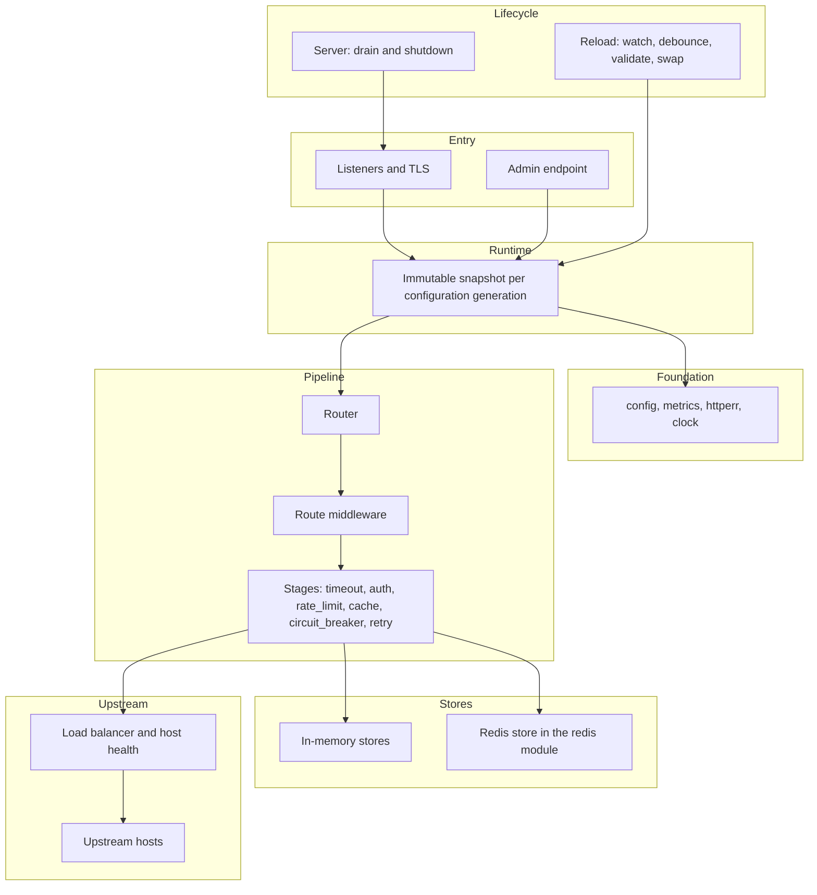
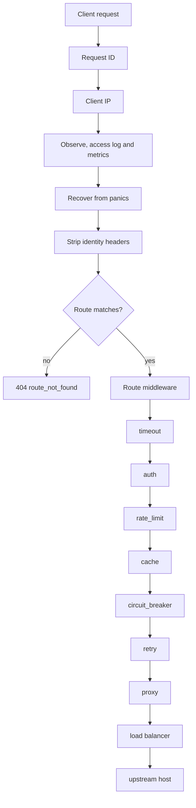

# go-microgateway

A microgateway and API gateway for Go that runs as an embeddable library or as a standalone binary.

Suggested topics: `api-gateway`, `microgateway`, `golang`, `reverse-proxy`, `rate-limiting`, `circuit-breaker`, `http-cache`, `redis`, `load-balancer`

## Features

- Routing by host, path (exact, prefix or pattern), method and header, with per-route path rewriting and header rules.
- Upstreams with several hosts, load balancing (`p2c`, `round_robin`, `weighted_round_robin`, `random`, `consistent_hash`), DNS-discovered hosts, and passive and active health checks.
- Per-host circuit breakers, retries limited by a retry budget, and idempotency keys.
- Authentication with JWTs (HMAC, RSA, ECDSA and EdDSA keys, static or from a JWKS endpoint) and API keys stored only as SHA-256 hashes, with scope and role checks.
- Rate limiting per client IP, consumer, header or route, with token bucket and sliding window algorithms, in memory or in a shared store, and explicit failure policies.
- An RFC 9111 response cache with `stale-while-revalidate`, `stale-if-error`, request coalescing, and purge by URL, tag or all entries.
- Built-in `cors`, `headers` and `request_size_limit` middleware, plus custom middleware and custom stores registered from Go.
- TLS listeners, HTTP/2 over ALPN and cleartext HTTP/2 (h2c), served by net/http's bundled HTTP/2 server with the configured limits.
- Graceful shutdown with a drain timeout, and hot reload on `SIGHUP` or on a change to the configuration file. A failed reload keeps the running configuration.
- An admin endpoint with liveness, readiness, the redacted configuration, upstream status, Prometheus metrics and authenticated cache purge.
- Strict configuration: unknown keys are rejected, `${VAR}` substitution is supported, and every validation error is reported with its path and line.

## Architecture overview



## Request flow



The stages and their order are described in [docs/architecture.md](docs/architecture.md) and [docs/middleware.md](docs/middleware.md).

## Requirements

- Go toolchain 1.27 or later, as declared in `go.mod` of both modules.
- Redis 6.2 or later, for the Redis store only. The core module does not need Redis.
- Platforms supported by the Go toolchain.

## Install

Library, core only:

```sh
go get github.com/ok0/go-microgateway
```

Embedding with the core module imports no Redis client. A program that also uses the Redis store imports `github.com/ok0/go-microgateway/redis`, which is a separate module.

Binary: the core module never imports a Redis client, so the binary that links the Redis store is built from the `redis` module:

```sh
go install github.com/ok0/go-microgateway/redis/cmd/microgateway@latest
```

or, from a checkout:

```sh
cd redis && GOWORK=off go build -o microgateway ./cmd/microgateway
```

## Quick start

From a checkout, validate and run the in-memory example. The command runs from the `redis` module because it registers the Redis store type that the examples may reference:

```sh
cd redis
go run ./cmd/microgateway validate -config ../examples/memory.yaml
go run ./cmd/microgateway run -config ../examples/memory.yaml
```

With the gateway running, the admin endpoint on `127.0.0.1:9901` answers without any upstream:

```sh
curl -i http://127.0.0.1:9901/livez
curl -i http://127.0.0.1:9901/readyz
```

The routes in the example forward to the upstreams named by `CATALOG_URL` and `ORDERS_URL`, which default to `127.0.0.1:9001` and `127.0.0.1:9101`. Start backends there, or set those variables to your own services, and then call a route:

```sh
curl -i http://127.0.0.1:8080/catalog/items
```

`examples/redis.yaml` runs the same routes with the rate limits and the response cache kept in a shared Redis server.

## Module layout

The repository holds two Go modules:

- The core module `github.com/ok0/go-microgateway` is the root of the repository. It holds the gateway, the public `config` and `store` packages, the internal packages, and the core examples.
- The Redis module `github.com/ok0/go-microgateway/redis` is in the `redis/` directory. It holds the Redis store, `redis.Option()`, the `microgateway` binary under `redis/cmd/microgateway`, and the Redis example program under `redis/examples`.

The Redis module requires the core module at a version and includes `replace github.com/ok0/go-microgateway => ../` for local development. No `go.work` file is committed.

## Documentation

- [Configuration reference](docs/configuration.md): every configuration block and key, defaults, and validation rules.
- [Architecture](docs/architecture.md): layers, request flow, pipeline order, reload semantics and the state each instance holds.
- [Middleware and stages](docs/middleware.md): authentication, rate limiting, circuit breaking, retries and the built-in middleware.
- [Caching](docs/caching.md): what the response cache stores, purge, and the shared-cache model.
- [Multi-instance deployment](docs/multi-instance.md): running several replicas, shared and per-instance state, and Redis operations.
- [Embedding](docs/embedding.md): using the gateway from Go, mounting it in `net/http`, custom middleware and custom stores.
- [Operations](docs/operations.md): the binary's commands and signals, the admin endpoint, metrics, logs and errors.
- [Examples](examples/): runnable configurations and the embedding program.

## License

Apache-2.0
