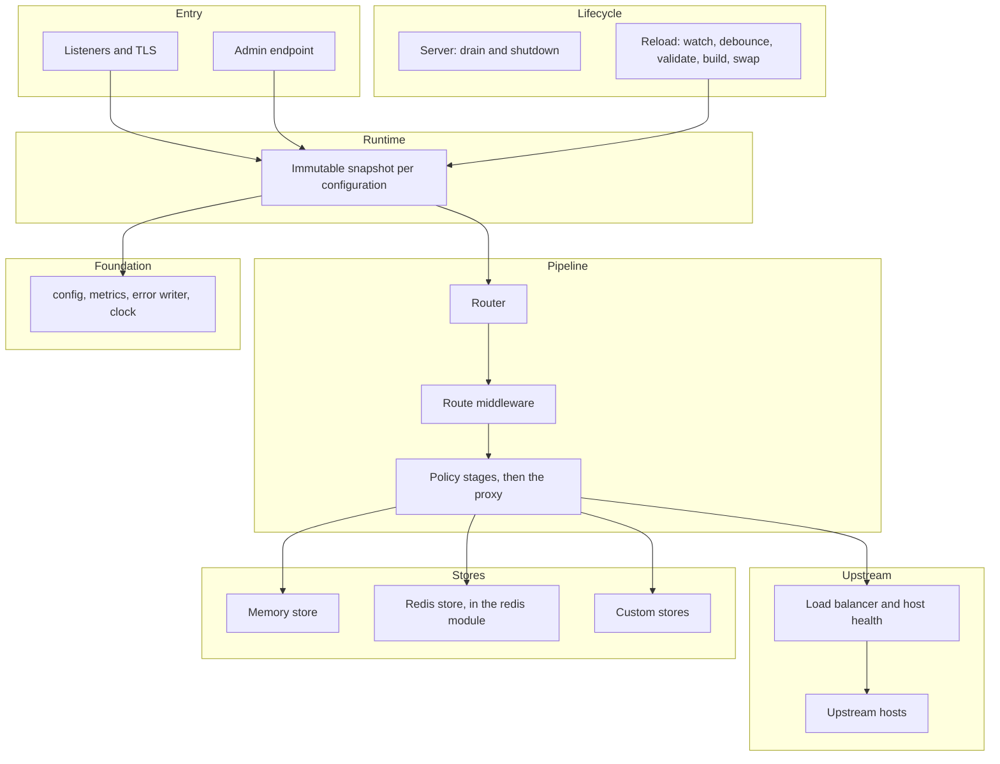
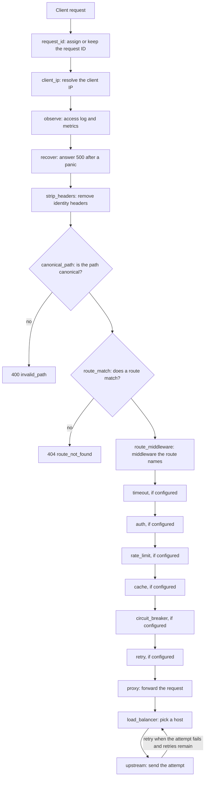

# Architecture

This page describes how the gateway is built: the layers, the path a request takes, the order of the policy stages, how a configuration reload reaches requests in flight, the two Go modules, and the state each running instance keeps.

## Layers

The gateway is a set of layers. Each layer depends only on the layers below it.

- **Entry.** The listeners accept connections. Each listener has an address, optional TLS, and the HTTP/1.1 and HTTP/2 settings from its configuration. The admin endpoint is a separate HTTP handler on its own address.
- **Lifecycle.** The server owns the listeners and performs the graceful drain on shutdown: it stops reporting ready, waits for `shutdown_delay`, then shuts down the HTTP servers within `drain_timeout`. The reload component watches the configuration file, debounces changes, parses and validates the new configuration, builds it, and swaps it in. The admin handler serves the health, configuration, upstream, metrics and purge endpoints.
- **Runtime.** A validated configuration becomes an immutable snapshot: the router, the route handlers, the upstream pools, and the bindings to named stores. A snapshot never changes after it is built.
- **Request pipeline.** The router selects a route. The route's middleware and policy stages run in order, and the terminal stage is the proxy. Authentication, rate limiting, the response cache, circuit breaking and retries are stages. Each is optional per route.
- **Upstream.** Each upstream holds its hosts, their health state, the connection pools, the DNS refresh for hosts discovered by name, and the load balancer that chooses a host for each attempt.
- **Stores.** A store holds state that the policy stages need to share: rate-limit counters and cached responses. The memory store is built in and keeps state inside the process. A Redis store is provided by the `redis` module. Custom stores implement the public `store` package contract.
- **Foundation.** The `config` package holds the schema, strict parsing and validation. The metrics registry produces Prometheus text. The error writer produces the JSON error body. The clock and the random source are injected.

Timers in this code use the injected clock. The one exception is the protocol timers that net/http's bundled HTTP/2 server runs itself, such as its ping and connection idle timers, which run on wall time.

## Request flow

For each request the gateway runs the steps below in this order. Each step has an id, and the diagram uses the ids as node names. The pipeline stages run only when the route configures them; a stage that is not configured is skipped and the request goes on to the next step.

1. `request_id` assigns a request ID from the configured header, or keeps a valid incoming ID.
2. `client_ip` resolves the client IP from the trusted proxies.
3. `observe` records the request for the access log and metrics.
4. `recover` answers `500` when a later step panics.
5. `strip_headers` removes the identity headers that a client could forge: the headers listed in `global.strip_identity_headers`, the headers that JWT providers forward claims in, and the consumer and metadata headers of API key providers. The step is skipped when that list is empty.
6. `canonical_path` canonicalizes the request path. A path that breaks the path rules gets `400` with the code `invalid_path` before any route policy runs; every later step, including the forwarded path, uses the canonical path.
7. `route_match` matches the route. When no route matches, the gateway answers `404` with the code `route_not_found`.
8. `route_middleware` stands for the middleware that the route names, in `middlewares` or in an explicit `pipeline`.
9. The pipeline stages `timeout`, `auth`, `rate_limit`, `cache`, `circuit_breaker` and `retry` run in this order, each only when the route configures it. [Default pipeline order](#default-pipeline-order) gives the conditions and how an explicit `pipeline` changes the order.
10. `proxy` forwards the request and sends the response back.
11. `load_balancer` picks a host for the attempt, and `upstream` sends the attempt to that host. When the attempt fails and the route's retry settings allow another attempt, the load balancer picks again. Every pick skips a host whose circuit breaker refuses it. The pick prefers a healthy host, one that is not ejected and passes its health checks, that the request has not tried yet; when there is none, it may pick a healthy host that the request already tried; and when no host is healthy, it falls back to the other hosts, untried ones first (panic mode).

## Default pipeline order

Without an explicit `pipeline`, a route runs its own middleware first and then the built-in stages in this order:

1. `timeout`
2. `auth`
3. `rate_limit`
4. `cache`
5. `circuit_breaker`
6. `retry`
7. `proxy`

A stage runs only when the route configures it. `timeout` runs when the route sets a timeout above zero. `auth` runs when `auth.mode` is not `none`. `rate_limit` runs when the route sets `rate_limit`. `cache` runs when `cache.enabled` is true. `circuit_breaker` runs when the route's upstream has a `circuit_breaker` block and the route does not set `circuit_breaker.enabled` to false; `enabled` is true by default. `retry` runs when the route sets `retry`.

The order has these consequences:

- `cache` sits after `rate_limit` and before `circuit_breaker`. A cache hit is served only to a request that has already been authenticated and admitted by the rate limit, so a hit is never served to an anonymous client or past a limit. The cache also sees the `503` that an open circuit breaker produces, so `stale-if-error` can serve a stored response in place of that error.
- `retry` is the innermost stage. Each retry is a new attempt within the same request, and the retry budget limits how many there are.
- Route middleware runs before the stages. With an explicit `pipeline`, route middleware that the pipeline does not name runs first, and the stages and middleware that the pipeline names follow in the order given. A built-in stage that the pipeline does not name does not run on that route, even when the route configures it. Validation therefore requires the pipeline to name `auth` when `auth.mode` is not `none` and `rate_limit` when the route sets `rate_limit`; an unnamed `timeout`, `cache`, `circuit_breaker` or `retry` is dropped without a validation error.

Validation rejects a `pipeline` that places `cache` before `auth`, because cache hits would be served without authentication. It also rejects `circuit_breaker` or `retry` before `cache`, and `retry` in any position but the last. Validation reports the stage and its index, for example `routes[0].pipeline[0] (line N): stage "cache" must come after "auth"`.

## Reload and request snapshots

A reload builds a complete new configuration before it changes anything. The new configuration is parsed, validated and built into a new snapshot. If any step fails, the running configuration stays active and the error is logged.

When the new snapshot is installed, each request keeps the snapshot it started with until it finishes. A request that started before the swap is handled entirely by the old configuration, and a request that starts after the swap is handled entirely by the new one. The old snapshot is released after its last request finishes, so state it owns, such as connections to upstreams, is closed only then.

Some settings cannot change without a restart, because they belong to the listeners or to the admin endpoint: the listener names, addresses, TLS settings, HTTP/2 settings, the timeouts and the header size limit of each listener, `admin.enabled`, `admin.address`, `admin.probes.enabled`, `admin.probes.address`, the log level and format, and the reload timings. When the binary reloads a file that changes one of these settings, it logs a warning named `restart required; change not applied` for each field, and the running value stays in effect.

## Two-module layout

The repository contains two Go modules, so that the core gateway does not depend on a Redis client:

- The core module `github.com/ok0/go-microgateway` is the repository root. It contains the gateway, the public `config` and `store` packages, the internal packages, and the example configurations and embedding program. Its standard library and direct dependencies do not include a Redis client.
- The Redis module `github.com/ok0/go-microgateway/redis` is in `redis/`. It contains the Redis store, `redis.Option()`, the `microgateway` binary, and a Redis example program. It requires the core module and depends on a Redis client library.

A configuration that references a `redis` store is rejected by a core-only validator, because the store type is not registered there. The binary and any program that registers the Redis option accept it.

## Shared and per-instance state

Each gateway instance keeps its own copy of most state. Some state lives in a shared store when one is configured, so that several instances behave as one for that feature. The table lists each kind of state, where it is kept, and what it means for operations. The consequences in production are described in [multi-instance.md](multi-instance.md).

| State | Where | Operational consequence |
|---|---|---|
| Rate-limit state | `store.RateLimiter` (memory = per instance; Redis or a custom shared store = shared) | memory: effective limit ~ N x limit; shared store: exact global limit, +1 RTT per limited request; during a store outage the `on_store_error: local` fallback limiter is per instance |
| Cache entries | `store.Cache` (memory = per instance; Redis or a custom shared store = shared) | shared store: an entry filled by one instance is a hit on every instance, freshness and `Age` from the store clock; memory: each instance fills its own copy |
| Purge state | `store.Cache` (purge markers/epochs live with the entries) | shared store: a purge accepted by one instance is honored cluster-wide on the next read, also by instances started later; memory: purge only on the receiving instance (`scope: instance`; fan out by calling each admin endpoint) |
| JWKS key sets | per instance (memory; bytes only through the instance's `KeySetFetcher`) | each instance fetches its JWKS; rotation is seen per instance within its refresh rules; no store is touched |
| Circuit breaker state | per instance | instances may disagree about an upstream's breaker for a while |
| Passive outlier ejection | per instance | a host ejected on one instance still receives traffic from the others |
| Active health state | per instance | each instance probes every host itself; instances may disagree about a host's health for a while |
| Config watch and reload | per instance | each instance converges when its own file changes or its own reload is called; no cross-instance coordination |
| In-flight request coalescing | per instance (the background revalidation runner likewise) | at most one upstream fill per key per instance (N per cluster); background revalidations run per instance |

Store failures follow one rule set for every store. Each store call has a timeout and goes through a guard that stops calls to a store that keeps failing. Rate limiting applies its `on_store_error` policy, the cache bypasses to the upstream, and an admin purge returns `503`. No request waits on a store call longer than that store's timeout, and while the guard is open no call is made to the store.
