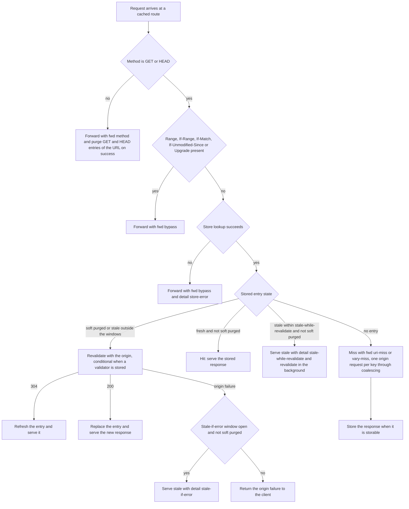
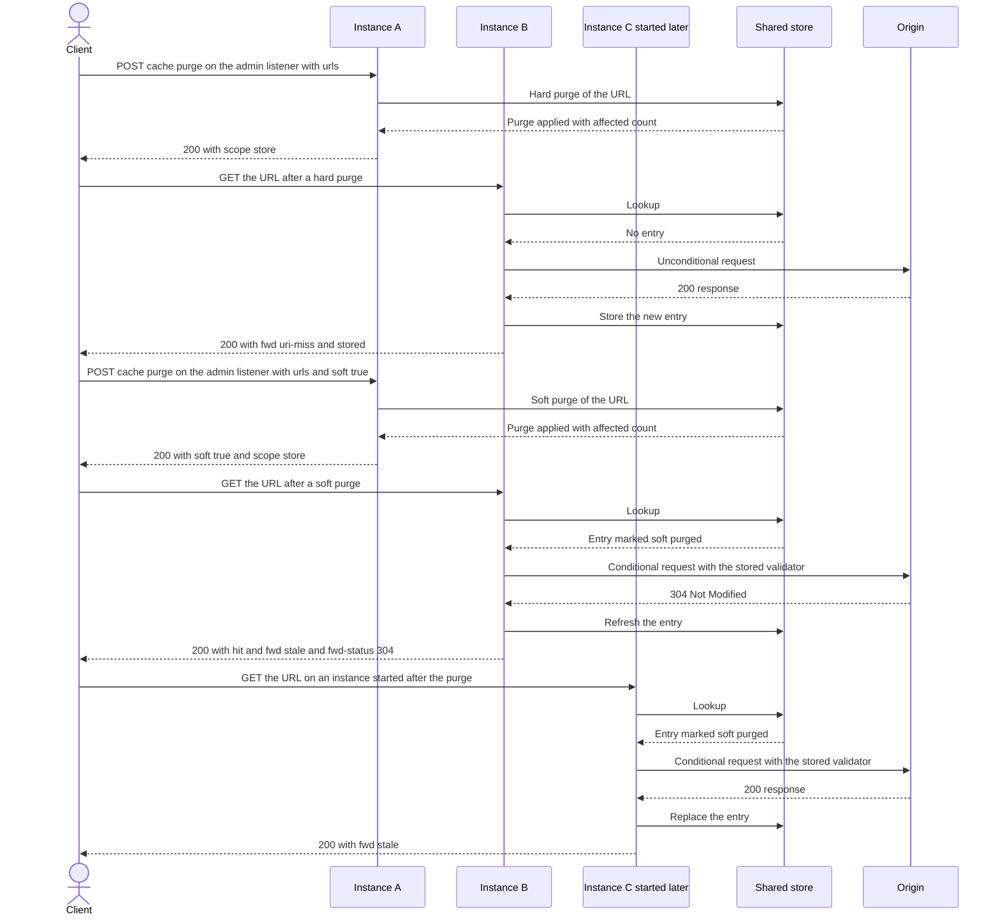

# Caching

The response cache lets a route answer repeated requests without contacting its upstream. It follows HTTP caching rules (RFC 9111): it stores only what the rules allow, serves a stored response only while the rules allow it, and revalidates with the origin otherwise. Cache results are reported in the `Cache-Status` header (RFC 9211).

The cache is shared in the sense that every instance that uses the same named store sees the same entries and the same purges. The built-in memory cache belongs to one instance.

## Enabling the cache

A route turns the cache on with `cache.enabled`. The top-level `cache` block sets the store and the limits that every cached route shares.

```yaml
cache:
  store: shared
  store_timeout: 100ms
  max_body_bytes: 1048576

routes:
  - name: catalog
    match:
      path: /catalog
      path_type: prefix
      methods:
        - GET
        - HEAD
    upstream: catalog
    cache:
      enabled: true
      default_ttl: 30s
      max_ttl: 5m
      stale_while_revalidate: 60s
      stale_if_error: 300s
```

Omit `cache.store` to use the built-in memory cache.

## Backends

| Backend | Configured by | Shared between instances | Notes |
|---------|---------------|--------------------------|-------|
| Memory | `cache.store` not set | No | Bounded by `cache.memory.max_bytes` (default `67108864`) and split into `cache.memory.shards` shards (default `16`). Least recently used entries are evicted when the bound is reached. |
| Named store | `cache.store` set to a `stores[].name` | Yes | The store must support caching. The Redis store does, when the redis module is linked into the binary. |

```yaml
cache:
  memory:
    max_bytes: 33554432
    shards: 16
```

## What is cached

- Methods: only `GET` and `HEAD` requests are answered from the cache and stored. Other methods are forwarded. When a forwarded request succeeds with a 2xx or 3xx status, the stored `GET` and `HEAD` entries for that URL are removed.
- Statuses: a response is stored only when its status is in the route's `statuses`. The default is `200`, `203`, `204`, `300`, `301`, `308`, `404`, `405`, `410`, `414` and `501`.
- Requests that carry `Authorization` are stored only when the response is `public`, has `s-maxage`, or has `must-revalidate`.

Not stored:

- a request with `Cache-Control: no-store`, or a response with `no-store` or `private`;
- a response with `Set-Cookie`, or a `Vary` header that lists `*` or more than 16 field names;
- a response to a request with `Range`, a `206` response, a `304` response, or a body that was not received completely;
- a response with `no-cache` that carries neither `ETag` nor `Last-Modified`;
- a response whose lifetime, including stale windows, is zero;
- a response whose surrogate-key header (see Purging) cannot be parsed;
- a body larger than `cache.max_body_bytes`, which is streamed to the client instead.

Requests that carry `Range`, `If-Range`, `If-Match`, `If-Unmodified-Since` or an `Upgrade` connection bypass the cache entirely and are forwarded. The `Cache-Status` member for them carries `fwd=bypass` and a detail value (see Cache-Status).

Responses are stored per URL and per the request header values named by their `Vary` header.

## Freshness

The lifetime of a stored response comes from the first of these that the response carries: `s-maxage`, `max-age`, `Expires` (with its `Date`), and otherwise the route's `default_ttl`. The lifetime is limited to the route's `max_ttl`, which defaults to `24h`. A `default_ttl` of `0` means a response without freshness information is stored only for revalidation.

Request directives are honored: `max-age`, `min-fresh`, `max-stale` and `no-cache`.

`stale_while_revalidate` and `stale_if_error` on the route apply when the origin does not state its own stale windows. A response's `stale-while-revalidate` and `stale-if-error` directives replace the route values. `keep` retains a validated entry for that long after its stale windows, so that a later request can still revalidate it.

## Conditional revalidation

A stored response that is no longer fresh is revalidated with the origin when it carries an `ETag` or a `Last-Modified` header. The request to the origin is then conditional, with `If-None-Match` or `If-Modified-Since`. A `304` refreshes the stored entry and its freshness. A `200` replaces the entry. An entry with neither validator is revalidated with an unconditional request.

## Stale responses

- `stale-while-revalidate`: a stale entry within this window is served at once, and the origin is contacted in the background to replace it. The answer carries `detail=stale-while-revalidate`.
- `stale-if-error`: when revalidation fails with a 500, 502, 503 or 504 status or with no response, a stale entry within this window is served. The answer carries `detail=stale-if-error` and the origin status in `fwd-status`.
- `max-stale` in a request serves a stale entry up to that age.

These windows never apply to a soft-purged entry (see Purging).

## Request coalescing

Concurrent misses for the same cache key on one instance share one origin request. Coalescing is not shared between instances. The coalescing settings are under `cache.coalescing`:

- `enabled` (default `true`) turns coalescing on or off;
- `timeout` (default `5s`) is how long a waiting request waits for the shared fetch. After that it sends its own request to the origin, and the response is not stored. The answer carries `detail=coalesce-timeout`;
- `max_keys` (default `10000`) bounds the keys that have a fetch in flight;
- `max_waiters` (default `1024`) bounds the requests that wait on one fetch.

A response served from another request's fetch carries `collapsed`.

## Cache-Status

Every response that passed through the cache stage carries one `Cache-Status` member named by `cache.name` (default `microgateway`, 1 to 128 printable ASCII characters). The members the gateway emits are:

- `hit`: the response was served from a stored entry, including a stale or revalidated answer.
- `fwd`: why the origin was contacted. `uri-miss` means no entry exists for the URL. `vary-miss` means an entry exists for the URL but not for the request's `Vary` values. `stale` means a stored entry was revalidated or served while stale. `method` means the method is not `GET` or `HEAD`. `bypass` means the cache was not used.
- `fwd-status`: the origin status that caused the forward. `304` means the stored entry was refreshed. `500`, `502`, `503` or `504` means a stale entry answered a failed revalidation.
- `stored`: the response was stored by this request.
- `ttl`: remaining freshness in whole seconds, for stored responses and hits.
- `collapsed`: the response came from a fetch that another request started.
- `key`: a hex digest of the cache key. It is present only when `cache.status_key` is `true`.
- `detail`: the reason for a bypass or a special answer. `only-if-cached` is the detail of a `504` answer with the `not_cached` code, when a request with `only-if-cached` finds no usable entry. `coalesce-timeout`, `stale-while-revalidate` and `stale-if-error` are described above. `store-error` means the cache store failed and the request bypassed the cache. `upgrade`, `range` and `precondition` mean the request was bypassed for those headers.

## Size limits and streaming

`cache.max_body_bytes` (default `1048576`, allowed `1` to `67108864`) is the largest response body that is stored. A response whose declared length is larger, or whose body grows past the limit while it is streamed, is passed to the client unchanged and is not stored. Its `stored` member is absent.

The memory backend is bounded by `cache.memory.max_bytes` as described under Backends.

## Store outage

Each store call is bounded by `cache.store_timeout` (default `100ms`). When the store cannot answer a lookup, or the store's guard has opened (see `stores[].guard`), the request is forwarded to the origin and answered with `fwd=bypass` and `detail=store-error`. A failed write does not change the response that the client receives. The gateway logs a warning when the cache store becomes unavailable, and logs an informational line when it recovers.

## Cache request flow



## Purging

A purge removes entries from the cache, or marks them invalid when it is soft. Purges are requested through the admin endpoint, or from Go with `Gateway.Purge`.

### Soft purge

A soft-purged entry is never served, neither fresh nor stale, and `stale-while-revalidate`, `stale-if-error` and `max-stale` do not apply to it. It is kept only as a validator: the first request after the purge revalidates synchronously with the origin using a conditional request from the stored `ETag` or `Last-Modified` (unconditional when it has neither), concurrent requests on one instance coalesce into one origin request, a 304 refreshes the entry, a 200 replaces it, and an origin failure is returned to the client, not the entry.

A hard purge removes the entry, so the next request is a miss.

### Selectors

Each purge has exactly one selector:

- `urls`: a non-empty list of absolute `http` or `https` URLs. A URL purge covers every `Vary` variant of the `GET` and `HEAD` entries for that URL.
- `tags`: a non-empty list of tags. The origin names the tags of an entry in the response header given by `cache.tag_header` (default `Surrogate-Key`). Tags are separated by `cache.tag_delimiter`, which is `space` (default) or `comma`. With `cache.strip_tag_header` set to `true` (the default), the header is removed from the stored copy and from responses to clients.
- `all`: `true` purges every entry of the cache.

### Purge endpoint

The endpoint is `POST /cache/purge` on the admin listener, `admin.address` (default `127.0.0.1:9901`). It is not served on the public listeners. The endpoint is present only when `admin.auth.keys` lists at least one key. Requests are authenticated with `Authorization: Bearer <token>`, where the token is compared with the `sha256:` hashes in `admin.auth.keys`.

The request body is one JSON object of at most 1 MiB. It holds exactly one selector (`urls`, `tags` or `all`), and may hold `soft` as a boolean. Any other field is rejected.

```json
{"urls": ["http://127.0.0.1:8080/catalog/items"], "soft": true}
```

A successful response is a JSON object with the fields `type` (`url`, `tag` or `all`), `soft`, `accepted` (the number of distinct selectors after canonicalization, or `1` for `all`), `affected` (the number of entries the store changed; omitted when the store does not report it) and `scope` (`instance` or `store`).

| Status | Code | When |
|--------|------|------|
| 200 | none | The purge was applied. The body has the fields described above. |
| 400 | `bad_request` | The body is not one JSON object, has no selector or more than one, has a field of the wrong type or an unknown field, or exceeds 1 MiB. |
| 401 | `unauthorized` | The `Authorization` header is missing or is not a Bearer token. The response carries `WWW-Authenticate: Bearer`. |
| 403 | `forbidden` | The token matches none of the keys. |
| 404 | `not_found` | No admin keys are configured, so the endpoint does not exist. |
| 404 | `cache_not_configured` | The token is valid, but no route enables caching. |
| 405 | `method_not_allowed` | The method is not `POST`. The response carries `Allow: POST`. |
| 503 | `store_unavailable` | The cache store is unavailable. |
| 503 | `service_unavailable` | Any other failure. |

Every admin response carries `Cache-Control: no-store`.

To compute the hash of a token for `admin.auth.keys`, hash the token with SHA-256 and prefix the hex digest with `sha256:`:

```bash
printf %s 'example-admin-token' | shasum -a 256
```

The digest for `example-admin-token` is `d2eadfb6e52d65b4bbf254e5046c0c495328b4d208f8b1591c229e62c5c6362f`, so the entry is `hash: "sha256:d2eadfb6e52d65b4bbf254e5046c0c495328b4d208f8b1591c229e62c5c6362f"`.

```bash
curl -i -X POST \
  -H 'Authorization: Bearer example-admin-token' \
  -H 'Content-Type: application/json' \
  -d '{"urls":["http://127.0.0.1:8080/catalog/items"]}' \
  http://127.0.0.1:9901/cache/purge
```

### Scope

The result reports the reach of the purge in `scope`:

- `instance` for the memory backend. The purge affects only the instance that received it. Another instance keeps its own entries until its own purge or expiry. To purge on every instance, send the purge to each instance's admin listener, or call `Gateway.Purge` on each instance.
- `store` for a named store. The purge is applied in the store, so every instance that uses the store sees it, including an instance started after the purge. The store keeps the purge marker for a retention period derived from the cache configuration.

### Gateway.Purge

`Gateway.Purge(ctx, req)` in Go runs the same purge service as the endpoint, without a credential. `req` is a `PurgeRequest` with the fields `URLs`, `Tags`, `All` and `Soft`, and exactly one selector. It returns a `PurgeResult` with the fields `Type`, `Soft`, `Accepted`, `Affected`, `AffectedKnown` and `Scope`. The errors, checked in order, are `ErrClosed` after `Close`, `ErrCacheDisabled` when no route enables caching, an error wrapping `ErrInvalidPurgeRequest` for a malformed request, an error wrapping `store.ErrUnavailable`, and the error of the context. Embedding details, including the other `Gateway` methods, are in [embedding.md](embedding.md).

## Cluster purge sequence



On the memory backend the same sequence does not hold: the purge on instance A changes only A, so B keeps answering from its own entries until they are purged or expire.
