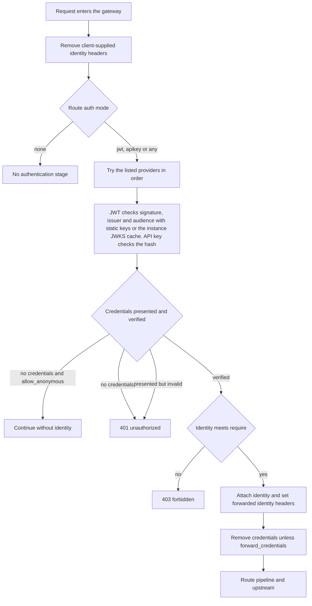
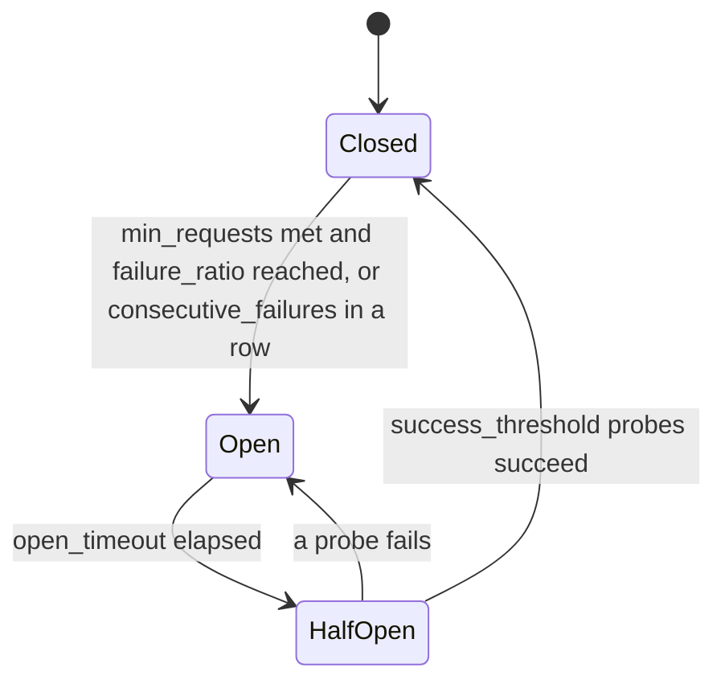
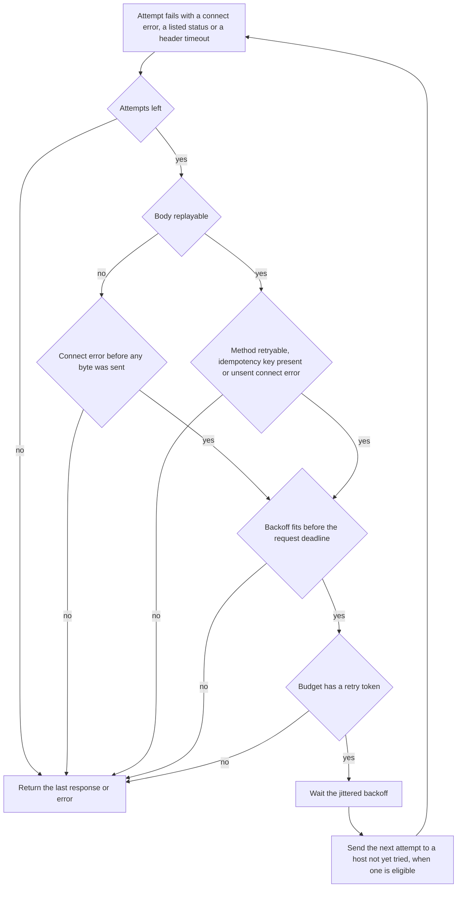

# Middleware

A request passes through three layers before it reaches an upstream:

1. Framework stages that run for every request: request ID, client IP, access log, panic recovery and identity-header stripping.
2. Built-in and user middleware named by the route in `middlewares`.
3. The route pipeline, which holds the stages `timeout`, `auth`, `rate_limit`, `cache`, `circuit_breaker` and `retry`.

Each stage is configured on its route. The complete key list is in the configuration reference. The YAML blocks below are fragments that show one feature each; they are not complete configurations unless a block is marked as one.

## Authentication

A route enables authentication with `auth`. The `mode` selects the providers that are tried, in the order listed in `providers`:

| Mode | Providers accepted | Notes |
|------|--------------------|-------|
| `none` | none | No authentication stage runs. `providers` and `require` must be empty. |
| `jwt` | JWT providers | Bearer tokens verified against the provider's keys. |
| `apikey` | API key providers | Keys matched by SHA-256 hash. |
| `any` | JWT and API key providers | The first provider that verifies the presented credentials wins. |

Providers are declared in the top-level `auth` block. A JWT provider checks the token signature, the `issuer` and one of the `audiences`. Static keys are declared under `keys`, and a remote key set is declared under `jwks`. A key set is fetched and cached by each gateway instance on its own.

```yaml
auth:
  jwt:
    - name: jwt-api
      issuer: https://auth.example.com
      audiences:
        - example-api
      keys:
        - kid: example-hs256
          algorithm: HS256
          secret: "${JWT_SECRET}"
    - name: jwt-remote
      issuer: https://auth.example.com
      audiences:
        - example-api
      jwks:
        url: https://auth.example.com/.well-known/jwks.json
        algorithms:
          - RS256
  api_keys:
    - name: clients
      header: X-API-Key
      consumer_header: X-Consumer-ID
      keys:
        - id: alice-1
          hash: "sha256:9771189e33ad49531f98873eb4e4458ce1c96f313fe15c6d753f4c7b6ad4eba5"
          consumer: alice
          scopes:
            - read
          roles:
            - reader
```

A route that requires a verified identity names its providers and may add conditions in `require`. Scopes and roles are read from the claims of a JWT (`scope_claim`, default `scope`, and `roles_claim`, default `roles`) or from the `scopes` and `roles` of an API key. A failed condition returns 403 `forbidden`.

```yaml
routes:
  - name: orders
    match:
      path: /orders
      path_type: prefix
    upstream: orders
    auth:
      mode: any
      providers:
        - jwt-api
        - clients
      require:
        scopes:
          - read
        roles:
          - reader
```

`allow_anonymous: true` lets a request through when it presents no credentials at all. A request that presents credentials that fail verification is still rejected with 401 `unauthorized`. `allow_anonymous` cannot be combined with `require`, and it is not valid with `mode: none`.

```yaml
routes:
  - name: catalog
    match:
      path: /catalog
      path_type: prefix
    upstream: catalog
    auth:
      mode: apikey
      providers:
        - clients
      allow_anonymous: true
```

### Identity headers

The gateway removes identity headers that a client may send itself before any route runs. The default list is `X-Consumer-ID`, `X-Consumer-Metadata`, `X-User-ID`, `X-Auth-Subject` and `X-Auth-Claims`. The list is set by `global.strip_identity_headers`, and the headers that providers forward are removed as well.

After a provider verifies a request, the gateway sets the identity headers for the upstream:

- the API key consumer name in `consumer_header`, and each `metadata_headers` entry in its named header;
- each JWT claim listed in `forward_claims` in its named header.

The credential itself is removed from the upstream request unless `forward_credentials: true` is set on the provider.

## Authentication flow



## Rate limiting

`rate_limit` limits requests on a route. It sets `RateLimit-Limit`, `RateLimit-Remaining` and `RateLimit-Reset` (seconds) on every response it decides on, and `Retry-After` on a rejection.

### Algorithms

`token_bucket` (the default) admits `rate` requests per `per` (default `1s`) with a `burst` capacity (default equal to `rate`). `sliding_window` admits `limit` requests per `window` (default `1m`).

```yaml
routes:
  - name: catalog
    match:
      path: /catalog
      path_type: prefix
    upstream: catalog
    rate_limit:
      algorithm: token_bucket
      rate: 10
      per: 1s
      burst: 20
      key:
        source: ip
  - name: orders
    match:
      path: /orders
      path_type: prefix
    upstream: orders
    auth:
      mode: jwt
      providers:
        - jwt-api
    rate_limit:
      algorithm: sliding_window
      limit: 100
      window: 1m
      key:
        source: consumer
```

### Keys

`key.source` selects what the limit is applied to:

| Source | Key | Notes |
|--------|-----|-------|
| `ip` (default) | Client IP | Client IP as resolved through `trusted_proxies`. |
| `consumer` | Authenticated consumer | Requires `auth` on the route. Falls back to the client IP when the request has no identity. |
| `header` | Value of the header named by `key.name` | `key.name` is required with this source and is not valid with any other. |
| `route` | The route as a whole | One shared counter for every request on the route. |

`max_keys` (default `100000`) bounds the number of keys kept in memory by one instance.

### Store choice

Without `store`, counters are kept in memory by each instance. With `store`, counters are kept in a named store that declares rate-limit support, so that every instance shares them. A store call that exceeds `store_timeout` (default `50ms`) or a store that is unavailable is handled by `on_store_error`:

- `local` (default when `store` is set): the instance's own in-memory limiter decides;
- `allow`: the request is admitted and the failure is logged at error level;
- `deny`: the request is answered with 503 `rate_limit_unavailable` and `Retry-After`.

```yaml
routes:
  - name: orders
    match:
      path: /orders
      path_type: prefix
    upstream: orders
    auth:
      mode: jwt
      providers:
        - jwt-api
    rate_limit:
      rate: 20
      per: 1s
      key:
        source: consumer
      store: shared
      on_store_error: deny
      store_timeout: 50ms
```

### Rejections

A request over the limit is answered with 429 `rate_limited`, with `Retry-After` set to the whole seconds until a token is available.

## Circuit breaker

An upstream with a `circuit_breaker` block gets an aggregate breaker that gates every request to the upstream, and each backend host gets a breaker that host selection consults. Both use the same settings and the same state machine, and each gateway instance keeps its own state. The route pipeline includes the `circuit_breaker` stage by default; a route opts out with `circuit_breaker: { enabled: false }`. When the upstream admits no request the route answers 503 `circuit_open`.

```yaml
upstreams:
  - name: orders
    hosts:
      - url: "${ORDERS_URL}"
    circuit_breaker:
      window: 10s
      buckets: 10
      min_requests: 20
      failure_ratio: 0.5
      consecutive_failures: 5
      open_timeout: 30s
      half_open_probes: 3
      success_threshold: 2
```

`window` and `buckets` define the sliding window in which failures are counted. `min_requests` is the number of requests the window must hold before `failure_ratio` is evaluated. `consecutive_failures` opens the breaker after that many failures in a row, and `0` disables that rule. `open_timeout` is how long the breaker stays open before it probes. `half_open_probes` bounds the trial requests in flight while half open, and `success_threshold` is the number of successful probes that closes the breaker.

## Circuit breaker state machine



## Retry

`retry` retries failed upstream exchanges on the same route. A retry is triggered by a connection failure, by a status listed in `on_statuses` (default `502`, `503` and `504`), or by a response header timeout when `504` is listed in `on_statuses`.

```yaml
routes:
  - name: catalog
    match:
      path: /catalog
      path_type: prefix
    upstream: catalog
    retry:
      attempts: 3
      base_delay: 25ms
      max_delay: 250ms
      on_statuses:
        - 502
        - 503
        - 504
      methods:
        - GET
        - HEAD
        - OPTIONS
        - PUT
        - DELETE
      idempotency_key:
        enabled: true
        header: Idempotency-Key
      budget:
        ratio: 0.1
        min_per_second: 10
        window: 10s
      max_body_bytes: 65536
```

`attempts` counts the first try, so `3` allows two retries. Waits use full-jitter backoff: each wait is drawn uniformly from zero up to `base_delay` doubled for each retry, capped at `max_delay`.

Only the methods in `methods` are retried. A method outside that list is retried when `idempotency_key.enabled` is set and the request carries a non-empty idempotency key header.

Request bodies are buffered so they can be replayed, up to `max_body_bytes` (default `65536`). A request with a larger body, or any body when `max_body_bytes` is `0`, is retried only on a connection failure that happened before any byte was sent.

## Retry and budget flow



The retry budget is per route and per gateway instance. Within `window`, retries are allowed up to `ratio` of the requests seen in that window, plus `min_per_second` multiplied by the window length; a retry that the budget refuses is not sent. Because each instance counts its own traffic, the retry load of N instances stays about `ratio` of their combined traffic.

## Timeout

`timeout` bounds the whole exchange of a route, measured on the gateway's clock. The default is no limit. An exchange that exceeds the bound is cancelled and, when no response has started, the client receives 504 `gateway_timeout`.

```yaml
routes:
  - name: reports
    match:
      path: /reports
      path_type: prefix
    upstream: reports
    timeout: 20s
```

## CORS

The `cors` middleware answers cross-origin requests. It is named in a route's `middlewares` and defined with `type: cors` in the top-level `middlewares` block. A preflight request, an `OPTIONS` request with `Access-Control-Request-Method`, is answered by the gateway with 204 and is not forwarded. A preflight from a disallowed origin is answered with 403 `forbidden`.

```yaml
middlewares:
  - name: browser-cors
    type: cors
    params:
      allowed_origins:
        - https://app.example.com
      allowed_methods:
        - GET
        - POST
      allowed_headers:
        - Authorization
        - Content-Type
      expose_headers:
        - X-Request-ID
      allow_credentials: true
      max_age: 600
```

`allow_credentials: true` cannot be combined with `"*"` in `allowed_origins`.

## Headers

The `headers` middleware adds, sets or removes headers on the forwarded request, on the response, or on both. It is defined with `type: headers`.

```yaml
middlewares:
  - name: edge-headers
    type: headers
    params:
      request:
        set:
          X-Env: example
        remove:
          - X-Debug
      response:
        add:
          X-Served-By: microgateway
        set:
          Cache-Control: no-cache
        remove:
          - X-Internal
```

Route-level `request_headers` and `response_headers` provide the same operations without a named middleware.

## Request size limit

The `request_size_limit` middleware refuses request bodies larger than `max_bytes`. A request whose declared length is larger is answered with 413 `payload_too_large` before the route runs. A body that grows past the limit while it is read replaces the route's response with 413 `payload_too_large`.

```yaml
middlewares:
  - name: upload-limit
    type: request_size_limit
    params:
      max_bytes: 1048576
```

### Built-in middleware parameters

Each built-in type takes its settings in `params`.

`cors` parameters:

| Param | Type | Default | Meaning |
|-------|------|---------|---------|
| `allowed_origins` | list of strings | none | Exact origins such as `https://app.example.com`, or `*` for any origin. |
| `allowed_methods` | list of strings | `GET`, `HEAD`, `POST` | Upper-case methods allowed for cross-origin requests. |
| `allowed_headers` | list of strings | none | Request header names allowed on preflight requests. |
| `expose_headers` | list of strings | none | Response header names exposed to cross-origin callers. |
| `allow_credentials` | boolean | `false` | Permits credentialed cross-origin requests. Not valid with `*` in `allowed_origins`. |
| `max_age` | integer | `0` | Preflight cache lifetime in seconds. `0` omits the header. |

`headers` parameters:

| Param | Type | Default | Meaning |
|-------|------|---------|---------|
| `request` | mapping | none | Edits the forwarded request. Holds `add`, `set` and `remove`. |
| `request.add` | map of header name to value | none | Appends values to the named headers of the forwarded request. |
| `request.set` | map of header name to value | none | Replaces the named headers of the forwarded request. |
| `request.remove` | list of header names | none | Removes the named headers from the forwarded request. |
| `response` | mapping | none | Edits the response. Holds `add`, `set` and `remove`. |
| `response.add` | map of header name to value | none | Appends values to the named response headers. |
| `response.set` | map of header name to value | none | Replaces the named response headers. |
| `response.remove` | list of header names | none | Removes the named headers from the response. |

`request_size_limit` parameters:

| Param | Type | Default | Meaning |
|-------|------|---------|---------|
| `max_bytes` | integer | required | Largest accepted request body in bytes. Must be positive. |

## Recovery, request ID and access log

These run for every request, on every route.

- Recovery: a panic in a handler is logged with the request ID and answered with 500 `internal_error`.
- Request ID: a valid incoming value of `global.request_id_header` (default `X-Request-ID`) is kept; otherwise a new identifier is generated. The identifier is set on the response, forwarded to the upstream and written to logs.
- Access log: one `request` line per request with the request ID, method, path, route, upstream (when one was used), status, duration and client IP. It is controlled by `global.log.access_log`, which is on by default.

## Cache

The `cache` stage serves and stores responses of a route. It is enabled per route with `cache.enabled` and configured in the top-level `cache` block. See [caching.md](caching.md) for the cache model, the purge endpoint and the `Cache-Status` header.

## User middleware

A middleware written in Go is registered with `WithMiddleware` under a type name and then named in a route's `middlewares` like a built-in one. See [embedding.md](embedding.md) for the factory, parameter decoding and request accessors.

## Pipeline ordering

The default route pipeline is `timeout`, `auth`, `rate_limit`, `cache`, `circuit_breaker`, `retry`. By default, route middlewares named in `middlewares` run before the pipeline.

A route can set its own `pipeline`. With an explicit pipeline:

- route middlewares that the pipeline does not name run before it;
- the stages run in the listed order;
- a stage that the pipeline omits does not run on that route.

Validation enforces three rules on the order: `cache` must come before `circuit_breaker` and `retry`, `retry` must be last when present, and `cache` must not come before `auth`. The third rule is what the example below shows.

Rejected configuration:

```yaml
version: 1

listeners:
  - name: public
    address: ":8080"

upstreams:
  - name: catalog
    hosts:
      - url: "http://127.0.0.1:9001"

auth:
  api_keys:
    - name: clients
      keys:
        - id: alice-1
          hash: "sha256:9771189e33ad49531f98873eb4e4458ce1c96f313fe15c6d753f4c7b6ad4eba5"
          consumer: alice

routes:
  - name: catalog
    match:
      path: /catalog
      path_type: prefix
    upstream: catalog
    auth:
      mode: apikey
      providers:
        - clients
    cache:
      enabled: true
    pipeline:
      - cache
      - auth
```

```text
routes[0].pipeline[0] (line 33): stage "cache" must come after "auth": cache hits would be served without authentication
rejected.yaml: 1 error(s)
```

The configuration above is rejected at every entry point: `microgateway validate`, startup, reload, and `New` or `Reload` in Go. Cache hits would be served before the authentication stage ran, so a client without a key would receive a stored response. Place `auth` before `cache`, or leave `pipeline` unset to use the default order.

A `cache` stage placed before `rate_limit` is accepted. Cache hits then return before the rate limit counts them, so hits bypass the limit. Use this order only when the origin is what needs protecting and serving hits without counting them is intended, such as a public read-only catalog. The default order counts hits against the limit.

Valid configuration:

```yaml
version: 1

listeners:
  - name: public
    address: ":8080"

upstreams:
  - name: catalog
    hosts:
      - url: "http://127.0.0.1:9001"

routes:
  - name: catalog
    match:
      path: /catalog
      path_type: prefix
    upstream: catalog
    rate_limit:
      rate: 10
      per: 1s
      key:
        source: ip
    cache:
      enabled: true
      default_ttl: 30s
    pipeline:
      - timeout
      - cache
      - rate_limit
```

The `cache` before `auth` rule applies only to a pipeline that lists `auth` after `cache`. A route whose pipeline has no `auth` stage, such as the valid example above, is not affected by it.
