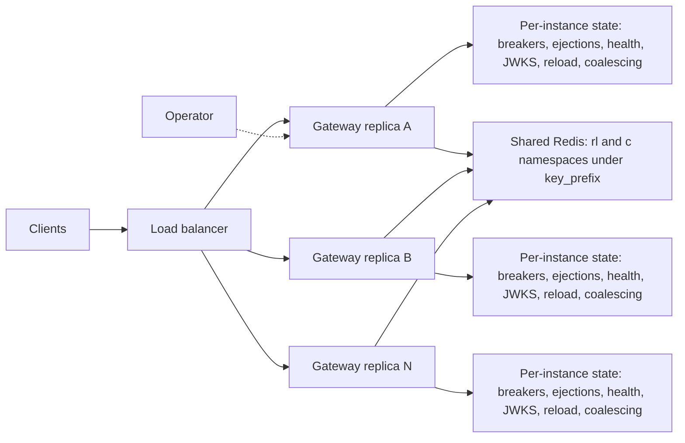

# Multi-instance deployment

This page covers running several identical gateway replicas behind a load balancer. It explains which state the replicas share, which they keep to themselves, how to configure the shared stores, how the gateway behaves when a store fails, and how to run Redis for the gateway.

## Multi-instance topology



The replicas run the same configuration and do not know about each other. The load balancer spreads client requests across them. Each replica has its own circuit breakers, health checks, JWKS key sets and in-memory state. When a shared store is configured, the rate-limit counters and the response cache are kept in Redis under the `rl` and `c` namespaces of its `key_prefix`, so every replica reads and writes the same values. An operator who purges the cache calls the admin endpoint of one replica. With a shared store that purge applies to all replicas. With in-memory cache state, the purge applies only to the replica that received it.

## Shared and per-instance state in operation

The table in [architecture.md](architecture.md#shared-and-per-instance-state) lists the nine kinds of state. Each row below states what the row means in operation and what the operator must do about it.

### Shared rows

- **Rate-limit state.** With a shared store, one limit applies across all replicas, and each limited request costs one extra round trip to the store. With in-memory counters, each replica enforces the limit on its own, so the effective limit is about N times the configured limit. Operator action: configure `rate_limit.store` for every route whose limit must be global.
- **Cache entries.** With a shared store, an entry filled by one replica is a hit on every replica, and its age is measured on the store clock. With in-memory entries, each replica fills and holds its own copy. Operator action: configure `cache.store` for a cache that should be shared, and keep the replicas' cache sizes in mind when the cache is in memory.
- **Purge state.** With a shared store, a purge accepted by one replica is applied on the next read by every replica, including replicas started after the purge. With in-memory state, a purge affects only the replica that received it. Operator action: for in-memory state, send the purge to every replica's admin endpoint, with `scope` reported as `instance` in each reply.

### Per-instance rows

- **JWKS key sets.** Each replica fetches its own key sets through its key-set fetcher and refreshes them under its own rules. Key rotation is seen by each replica within its refresh interval, so a rotated key may be accepted by some replicas before others. Operator action: keep the JWKS endpoint reachable from every replica, and allow for the refresh delay when rotating keys.
- **Circuit breaker state.** Each replica opens and closes its breakers on its own failure counts, so replicas may disagree about an upstream for a while. Operator action: none in the gateway. Watch the per-replica breaker metrics when an upstream degrades.
- **Passive outlier ejection.** A host ejected by one replica still receives traffic from the others until they eject it too. Operator action: none in the gateway. Each replica's upstream status shows its own view.
- **Active health state.** Each replica probes every host itself, so probe load grows with the number of replicas, and replicas may disagree about a host's health. Operator action: size the upstreams with the probe load of N replicas in mind.
- **Config watch and reload.** Each replica reloads when its own configuration file changes, or when its own reload is called. Replicas converge only as fast as the configuration reaches each of them. Operator action: distribute configuration changes to all replicas, and check each one after a change.
- **In-flight request coalescing.** Each replica sends at most one upstream fill per key at a time, so the cluster sends at most N fills per key. Background revalidations also run per replica. Operator action: none in the gateway.

## Design limits

- No circuit breaker, outlier ejection, active health state, JWKS key set or in-flight coalescing is shared between replicas.
- Configuration distribution is the operator's job. The gateway has no coordination between replicas for reloads, so replicas may run different configurations while a change rolls out.
- In-memory rate-limit counters and in-memory cache entries exist per replica.
- With a shared rate-limit store, the limit is exact across replicas, at the cost of one store round trip per limited request.
- Each replica exposes its own metrics. Aggregate counters across replicas in the metrics system.

## Selecting stores

A store is a named entry in `stores[]`. It has a `name`, a `type` and the settings for that type. The gateway supports the built-in memory store and a `redis` type from the `redis` module. Features refer to a store by its name:

- `routes[].rate_limit.store` names the store that holds the counters of that route. Omit it to keep the counters in memory.
- `cache.store` names the store that holds the response cache. Omit it to keep the cache in memory for each replica.

One Redis deployment can serve both features. Reference the same store from `rate_limit.store` and `cache.store`, or use two store entries that point at the same server with different `key_prefix` values.

The `key_prefix` (default `microgateway`) namespaces every key the gateway writes. It must not be empty and must not contain `{` or `}`. Replicas of one gateway use the same prefix so that they share state. Environments, or unrelated gateways that must not share counters or cache entries, use different prefixes. Rate-limit counters are identified by the route name, the limit and the client key. Cache entries are identified by the request method, scheme, host, path and query, so every gateway that uses the same prefix and cache store shares the entries for the same request.

## The redis block

A store with `type: redis` has a `redis` block. Its fields and their defaults are:

- `mode`: `standalone` (default), `sentinel` or `cluster`.
- `addresses`: a list of `host:port` values, without a scheme or user information. Standalone mode takes exactly one address. Sentinel mode takes the sentinel addresses. Cluster mode takes the cluster nodes.
- `master_name`: required in sentinel mode and not allowed in other modes.
- `username`, `password`: the Redis credentials. Use `${VAR}` for the password so that the value comes from the environment.
- `sentinel_username`, `sentinel_password`: credentials for the sentinels. Allowed only in sentinel mode.
- `db`: the database number, default `0`. Must be `0` in cluster mode.
- `tls`: `enabled`, `ca_file`, `cert_file` and `key_file` (set together), `server_name` and `insecure_skip_verify`. The fields other than `enabled` are allowed only when `enabled` is `true`. File paths are resolved relative to the configuration file.
- `dial_timeout` (default `1s`), `read_timeout` (default `500ms`) and `write_timeout` (default `500ms`). Each must be positive.
- `pool_size` and `min_idle_conns`. A `pool_size` of `0` selects the client library default. `min_idle_conns` must not exceed a set `pool_size`.
- `key_prefix`: as described in [Selecting stores](#selecting-stores).

Secret values never appear in `/config` or in logs. The complete example below is a configuration that the redis module validates. It uses only the environment variables that the examples define:

Valid configuration:

```yaml
version: 1

listeners:
  - name: public
    address: ":8080"

stores:
  - name: shared
    type: redis
    redis:
      mode: standalone
      addresses: ["${REDIS_ADDR}"]
      password: "${REDIS_PASSWORD}"
      key_prefix: example-gateway
      dial_timeout: 1s
      read_timeout: 500ms
      write_timeout: 500ms
    guard:
      consecutive_failures: 3
      open_timeout: 2s

cache:
  store: shared
  store_timeout: 100ms

upstreams:
  - name: catalog
    hosts:
      - url: "${CATALOG_URL:-http://127.0.0.1:9001}"

routes:
  - name: catalog
    match:
      path: /catalog/
      methods: [GET, HEAD]
    upstream: catalog
    rate_limit:
      rate: 10
      per: 1s
      burst: 10
      store: shared
      on_store_error: local
      store_timeout: 50ms
    cache:
      enabled: true
      default_ttl: 30s
      max_ttl: 5m
```

The `redis` block is the same in every mode except for the fields noted above. Sentinel setups list the sentinel addresses in `addresses` and set `master_name`. Cluster setups list the nodes in `addresses` and keep `db` at `0`.

## Failure policies

### Rate limiting

The store guard and the timeout decide when a store call counts as a failure. A rate-limit call that takes longer than the route's `store_timeout` (default `50ms`) is a failure. A failed call applies the route's `on_store_error` policy:

- `local` (default): the replica decides the request with its own in-memory counters for that route. During an outage the limit is therefore per replica.
- `allow`: the request is admitted without a limit. The replica logs each such failure at error level.
- `deny`: the request is refused with status `503` and code `rate_limit_unavailable`. The `Retry-After` header carries the store's `guard.open_timeout` in whole seconds, at least `1`.

When the store answers again, the shared limits resume, and the replica logs that the store recovered.

### Store guard

Every store has a guard, configured under `stores[].guard`:

- `consecutive_failures` (default `3`): the number of consecutive failed calls that opens the guard.
- `open_timeout` (default `2s`): how long the guard stays open before a probe call is allowed.
- `max_inflight` (default `1024`): the number of store calls that may run at once. Calls beyond that number fail at once, and the policy applies.

While the guard is open no call is made to the store, so a request does not wait for a store that is known to be down. A request waits at most the store's timeout for any call that reaches the store. These bounds mean that no request blocks on a store longer than that timeout.

### Response cache

A cache call that fails, or that finds the guard open, makes the request bypass the cache, and the request goes to the upstream. The cache call has its own timeout, `cache.store_timeout` (default `100ms`), and a call that exceeds it counts as a failure. An admin purge that cannot reach the store returns `503` with code `store_unavailable`. A purge of in-memory state is not affected by a store outage.

## Degradation signals

Use these to see that a replica is running without its shared store:

- Gauge `microgateway_store_available{store}`: `1` when the store is available to the replica, `0` when it is not.
- Counter `microgateway_store_errors_total{store, op}`: failed store calls by store and operation.
- Counter `microgateway_ratelimit_store_fallback_total{route, policy}`: requests decided by a failure policy, with the policy name `local`, `allow` or `deny`.
- Counter `microgateway_cache_store_errors_total{op}`: failed cache store calls by operation.
- Counter `microgateway_cache_requests_total{route, result}`: cache requests by result. A store outage shows as `bypass`.

The replica also writes these log messages:

- Warning `rate limit store unavailable; failure policies active`, with the store and the policies in use.
- Information `rate limit store recovered; shared limits resumed`.
- Warning `cache store unavailable; requests bypass the cache`, with the store.
- Information `cache store recovered; cache resumed`, with the store.
- Warning `rate limit store call failed; failure policy applied`, with the policy, the store and the error. The replica suppresses repeats of this message and reports the count it suppressed.
- Error `rate limit store failed; request admitted`, for the `allow` policy.

## Redis tuning and operations

- **Version.** Use Redis 6.2 or later. The gateway's scripts depend on script effects replication.
- **Dedicated instance.** Run a Redis instance for the gateway, or at least one with its own memory limit, so that no other workload competes for memory. Set `maxmemory-policy` to `allkeys-lru` as the fallback policy. Every key the gateway writes carries an expiry, and the cache keeps each bookkeeping value in two keys with the same lifetime. Losing one of the two keys changes no cache lookup. Losing both keys of one pair is not covered: a purged entry may then be served again. Size the memory so that eviction does not reach cache keys. Rate-limit counters are not cache entries: evicting one resets that client's counter.
- **Memory sizing.** Estimate the memory as the number of live cache entries times the average entry size, plus one counter key for each active client on each limited route. A cache entry holds its body, which is limited by `cache.max_body_bytes` (default `1048576`), and its headers and bookkeeping. The `cache.memory.max_bytes` setting limits only the in-memory cache, not Redis.
- **Persistence.** Persistence is not required. After a restart that loses the data, the counters start at zero and the cache refills.
- **Timeouts.** `dial_timeout`, `read_timeout` and `write_timeout` bound each Redis call. Set `store_timeout` for the rate limit and for the cache above the normal round-trip time to the Redis server. A shorter value makes requests fall back to their policies more often.
- **Pool sizing.** Each replica opens up to `pool_size` connections. The total connection count is the number of replicas times `pool_size`, or times the client default when `pool_size` is `0`. Set the server's `maxclients` above that total, and use `min_idle_conns` to keep connections warm.
- **Sentinel.** During a failover, calls fail until the sentinels report the new master. The failure policies apply to those calls.
- **Cluster.** Scripts declare every key they use, and each script touches keys in one slot. A `MOVED` or `ASK` reply during resharding fails only the call that received it. The client refreshes its slot map before the next call. The cluster client adds one second to some key lifetimes so that they outlive clock differences between nodes.
- **Server clock.** Redis decides every limit and cache time. Each script reads the server time with `TIME`, so the clocks of the replicas do not affect limits or freshness. If the Redis clock steps backwards, an entry whose deadline has passed may be visible again until its deadline passes again. Purges stay in effect across such a step.

## Using Redis from Go

A program that embeds the gateway registers the Redis store type with `redis.Option()` from the `redis` module:

```go
gw, err := microgateway.NewFromYAML(data, redis.Option(), microgateway.WithLogger(logger))
if err != nil {
	return err
}
```

The option registers the type `redis` for rate limiting and for the response cache. The gateway builds one store for each referenced store entry, and it closes the store when no generation of the configuration uses it. The complete program is in [redis/examples/redisgateway/main.go](../redis/examples/redisgateway/main.go).

## Custom stores

A program can register its own store type with `microgateway.WithStoreType`. The call takes the type name, the capabilities the store provides (`store.CapRateLimit`, `store.CapCache`, or both) and a factory. The factory receives the store's name, its type and its parameters, and it returns a `store.Backend` that implements the capabilities it declares. The gateway calls the factory once for each store entry that uses the type, and closes the backend when no generation uses it. The embedding guide, [embedding.md](embedding.md), shows a complete example.
