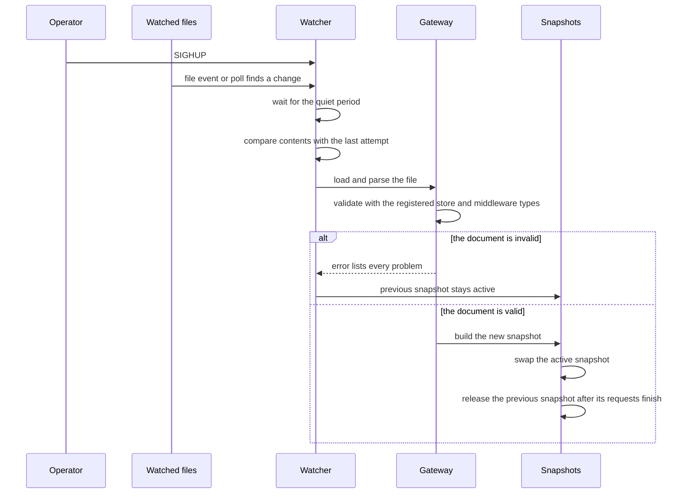

# Operations

This guide covers running the `microgateway` binary: its commands and flags, signals and shutdown, hot reload, TLS and HTTP/2, the management and probe listeners, the metrics it exports, its logs and the error responses it writes. The configuration keys are described in the [configuration reference](configuration.md). The cache purge API is described in the [caching guide](caching.md). Running several replicas is covered in the [multi-instance guide](multi-instance.md). Embedding the gateway in a Go program is covered in the [embedding guide](embedding.md).

## Commands

The binary is built from the Redis module, which registers the `redis` store type in addition to the in-memory stores:

The `redis` store needs Redis 6.2 or later; CI tests it on Redis 6.2 and 7.4.

```
cd redis && go build -o microgateway ./cmd/microgateway
```

| Command | Flags | Meaning |
|---------|-------|---------|
| `run` | `-config`, `-log-level`, `-log-format` | Serves the gateway until it receives an interrupt or termination signal. |
| `validate` | `-config` | Checks a configuration file and reports every problem it finds. |
| `version` | none | Prints the version, commit and build date. A binary installed with `go install …@vX.Y.Z` reports `vX.Y.Z`; a build without a version, such as a plain `make build` or `go build`, reports `dev`. |

Flags:

- `-config` is required by `run` and `validate`. It is the path of the configuration file.
- `-log-level` takes `debug`, `info`, `warn` or `error` and overrides `global.log.level`. It is accepted by `run` only.
- `-log-format` takes `json` or `text` and overrides `global.log.format`. It is accepted by `run` only.

An invalid `-log-level` or `-log-format` value, a missing `-config` or an unexpected argument exits with status 2 before the file is read. `validate` prints `<path>: configuration is valid` with the number of listeners, upstreams and routes when the file is valid. Otherwise it prints one `path (line N): message` line per problem, then `<path>: N error(s)`, and exits with status 1.

Exit statuses: `0` on success, `1` when the configuration is invalid, a listener fails or a shutdown is forced, and `2` for a usage error. `help`, `-h` and `--help` print the usage text.

## Signals and shutdown

- `SIGHUP` starts a reload attempt at once, even when the watched files have not changed. The log line `reload requested` is written first. See [Hot reload](#hot-reload).
- `SIGINT` and `SIGTERM` start a graceful shutdown. The gateway logs `shutting down` and then runs these steps in order:
  1. Readiness turns false. `/readyz` on the probe listener and on the management listener returns `503` with `not_ready`, so a load balancer can stop sending new traffic.
  2. The gateway keeps serving for `global.shutdown_delay` (default `5s`). Readiness stays false and new requests are still served, so a load balancer or Kubernetes can remove the instance from its endpoints before the listeners stop.
  3. The listeners stop accepting connections. In-flight requests get up to `global.drain_timeout` (default `20s`) to finish. The log line `drain complete` is written when they all finish. The probe and management listeners keep serving until the drain ends and then close; the probe listener closes last.
  4. If the drain timeout elapses, the remaining connections are closed and `drain timeout; connections force-closed` is logged at warn level. The process then exits with status 1.
  5. The gateway is closed and `stopped` is logged.
- A second `SIGINT` or `SIGTERM` during the delay or the drain forces the shutdown at once. The log line `second signal; forcing shutdown` is written, remaining connections are closed and the process exits with status 1.
- A `SIGHUP` received during the shutdown is ignored and logged as `reload ignored; shutting down`.
- A reload updates `global.shutdown_delay` and `global.drain_timeout` for the next shutdown.

### Shutdown timing

- Keep `shutdown_delay + drain_timeout + margin <= terminationGracePeriodSeconds`, with a margin of at least 5 s for closing the gateway and the process exit. The defaults, 5 s + 20 s + 5 s, add up to 30 s, the Kubernetes default. Raise `terminationGracePeriodSeconds` when you raise either value.
- During the delay `/readyz` returns `503` and requests are still served.
- During the shutdown delay and the drain `/readyz` returns `503` on the probe listener, and `/livez` keeps returning `200`.
- Each instance applies its own delay and drain when it receives the signal. Instances do not coordinate, and no shared store is used.
- To restore the earlier behavior (listeners stop at once, 30 s drain), set these keys in the configuration:

  ```yaml
  global:
    shutdown_delay: 0s
    drain_timeout: 30s
  ```

  These values no longer leave the 5 s margin under the 30 s default grace period.

## Hot reload

A reload attempt starts in one of these ways:

- A change to a watched file. The watched files are the configuration file, the certificate and key files of every TLS listener, and every key file the configuration references. Changes are found by file events and by a check of the files every `global.reload.poll_interval` (default `5s`). A change waits for a quiet period of `global.reload.debounce` (default `250ms`); a burst of changes waits at most ten debounce periods. Before the attempt, the file contents are compared with the last attempt, so a change that leaves the content the same does not reload.
- `SIGHUP`, which starts an attempt without the debounce and without the content comparison.
- The embedding API, which calls `Gateway.ReloadFile`, `Gateway.ReloadYAML`, `Gateway.Reload` or `Gateway.WatchFile` directly.

## Hot reload sequence



## Hot reload behavior

- An attempt that yields the same configuration as the running one is counted as `unchanged` and logged at debug level.
- A valid new configuration is swapped in atomically. A request uses the snapshot that was active when it started, and a new request uses the new snapshot. The previous snapshot's resources are released when its last request and its background cache refreshes finish. A successful reload is counted as `success` and logged as `configuration reloaded`, with the number of routes and upstreams added, removed or changed.
- An invalid configuration (a parse, validation or build error) keeps the running configuration. The gateway logs `configuration reload failed; previous configuration remains active` at warn level with every error, and counts a `failure`.
- Stateful components are kept across a reload. Each component is keyed by its kind, its name and a fingerprint of its own definition. The upstream pools with their health checks, ejections and breakers, the JWKS key sets, the rate-limit counters of the in-memory store, the retry budgets, the response cache and the store connections are reused while their definition is unchanged. A component whose definition changed starts with empty state.
- Certificate and key file changes take effect through the same path. New TLS handshakes use the new certificate, and established connections are not affected.
- Some settings cannot change while the gateway runs. For each of these the reload logs `restart required; change not applied` at warn level, and the running value is kept. The other changes in the same file still apply.
  - `listeners` (the set of names, and per listener `name`, `address`, `tls`, `tls.min_version`, `http2`, `h2c`, `read_header_timeout`, `read_timeout`, `write_timeout`, `idle_timeout` and `max_header_bytes`)
  - `admin.enabled` and `admin.address`
  - `admin.probes.enabled` and `admin.probes.address`
  - `global.log.level` and `global.log.format`
  - `global.reload.debounce` and `global.reload.poll_interval`

## TLS and HTTP/2

- A listener with a `tls` block serves HTTPS. `tls.cert_file` and `tls.key_file` are PEM files. `tls.min_version` is `1.2` (the default) or `1.3`.
- `http2` defaults to `true`. On a TLS listener it enables HTTP/2 through ALPN, with `http/1.1` as the fallback. With `http2: false` the TLS listener offers HTTP/1.1 only.
- `h2c: true` on a listener without TLS accepts HTTP/2 over cleartext from clients that start with the HTTP/2 preface. Without `h2c`, a cleartext listener serves HTTP/1.1 only.
- HTTP/2 is served by the Go standard library's bundled HTTP/2 server. The configuration has no HTTP/2-specific keys. The listener's `read_timeout`, `write_timeout` and `idle_timeout` also bound HTTP/2 streams and connections, and the other HTTP/2 limits keep the standard library defaults. HTTP/2 deadlines are measured on the wall clock.
- `read_header_timeout` defaults to `10s`, `idle_timeout` to `120s` and `max_header_bytes` to `1048576`. `read_timeout` and `write_timeout` default to `0`, which means no limit.

## Admin listeners

The binary binds two listeners besides the data listeners, each per instance: the management listener on `admin.address` (default `127.0.0.1:9901`, loopback only) and the probe listener on `admin.probes.address` (default `:9902`, all interfaces).

### Management listener

The admin endpoint is a separate listener. Its address is `admin.address` (default `127.0.0.1:9901`). Set `admin.enabled: false` to run without it. The data listeners never serve admin paths. A non-loopback `admin.address` needs at least one `admin.auth.keys` entry, and `/config`, `/upstreams` and `/metrics` on it then need a bearer token; see `admin.auth.management` in the [configuration reference](configuration.md#admin). `admin.auth.management` selects one of three modes: `auto` (the default) needs a token only on a non-loopback address, `required` always needs one, and `none` never does and logs a warning on a non-loopback address.

In Kubernetes, reach the loopback management port with `kubectl port-forward pod/<pod> 9901:9901`, then `curl http://127.0.0.1:9901/config`; the port-forward connects to the pod's loopback interface.

```
kubectl port-forward pod/<pod> 9901:9901
curl http://127.0.0.1:9901/config
```

The admin listener serves HTTP/1.1 only, with a header read timeout of `10s` and an idle timeout of `120s`. Every admin response carries `Cache-Control: no-store`.

Endpoints:

- `GET` and `HEAD /livez` returns `200` with `{"status":"ok"}`.
- `GET` and `HEAD /readyz` returns `200` with `{"status":"ready"}` while the gateway is ready, and `503` with `{"status":"not_ready"}` once shutdown has begun.
- `GET` and `HEAD /config` returns `200` with the active configuration as JSON. Secret values are redacted.
- `GET` and `HEAD /upstreams` returns `200` with a JSON list of the upstream host status. The list is empty when there are no upstreams.
- `GET` and `HEAD /metrics` returns `200` with the metrics in the Prometheus text format.
- `POST /cache/purge` removes cached responses. Its request, response and error cases are described in the [caching guide](caching.md). It is available only when `admin.auth.keys` contains at least one key and a cache is configured. A request needs an `Authorization: Bearer` header whose token matches one of the keys. A missing or malformed header returns `401` with `unauthorized`. A token that matches no key returns `403` with `forbidden`.
- Any other path returns `404` with `not_found`. A method that the path does not accept returns `405` with `method_not_allowed`, and the `Allow` header lists the accepted methods (`GET, HEAD` for the read endpoints and `POST` for the purge endpoint).

### Probe listener

The probe listener serves `GET` and `HEAD` on `/livez` and `/readyz`, and on `/metrics` only when `admin.probes.metrics` is `true`. Every other path returns `404` with `not_found`, and no credential is ever needed. It never serves configuration, upstream state or purge. It is plain HTTP/1.1 even when a data listener uses TLS, with a `10s` header read timeout and a `120s` idle timeout. It is bound even when `admin.enabled` is `false`. Point kubelet `httpGet` probes at it.

`admin.probes.metrics: true` lets Prometheus scrape the pod IP without a token, but anyone who can reach the port can read the metrics. Keep it `false` unless the pod network is trusted, and otherwise scrape the management listener with a token or through a sidecar.

A change to `admin.probes.address` or `admin.probes.enabled` (as for `admin.address` and `admin.enabled`) is restart-required: the reload logs `restart required; change not applied` and the running listener stays. `admin.probes.metrics` applies on reload.

A bind failure, including a port already used by another listener, stops startup with an error naming `listener "probe"` and the address. Turn the listener off with `admin.probes.enabled: false`.

## Metrics

The metrics are served at `/metrics` on the admin listener. The gateway registers 32 metric families, grouped below by feature. The labels are listed in the order the gateway registers them.

### Requests

| Metric | Type | Labels | Meaning |
|--------|------|--------|---------|
| `microgateway_requests_total` | counter | `route`, `method`, `code` | Requests handled, by route, method and status code. The route label is `unmatched` when no route matches. |
| `microgateway_request_duration_seconds` | histogram | `route` | Time from request receipt to handler completion, by route. |

### Upstreams

| Metric | Type | Labels | Meaning |
|--------|------|--------|---------|
| `microgateway_upstream_attempts_total` | counter | `upstream`, `host`, `outcome` | Upstream attempts, by upstream, host and outcome. |
| `microgateway_upstream_ejections_total` | counter | `upstream`, `host` | Passive outlier ejections of an upstream host. |
| `microgateway_upstream_ejections_refused_total` | counter | `upstream` | Ejections refused by the `max_ejection_percent` limit. |
| `microgateway_upstream_dns_refresh_total` | counter | `upstream`, `result` | DNS refreshes of an upstream, by result. |
| `microgateway_upstream_active_checks_total` | counter | `upstream`, `host`, `result` | Active health probes, by result. |
| `microgateway_upstream_host_healthy` | gauge | `upstream`, `host` | Whether an upstream host is currently healthy. |
| `microgateway_upstream_panic_mode` | gauge | `upstream` | Whether an upstream is in panic mode. |

### Circuit breakers

| Metric | Type | Labels | Meaning |
|--------|------|--------|---------|
| `microgateway_circuit_breaker_state` | gauge | `upstream`, `host` | Circuit breaker state: 0 closed, 1 half-open, 2 open. The host label is empty for the upstream aggregate. |
| `microgateway_circuit_breaker_transitions_total` | counter | `upstream`, `host`, `from`, `to` | Circuit breaker state transitions. |
| `microgateway_circuit_breaker_rejected_total` | counter | `upstream`, `host` | Requests or attempts rejected by an open circuit breaker. |

### Retries

| Metric | Type | Labels | Meaning |
|--------|------|--------|---------|
| `microgateway_retries_total` | counter | `route` | Retry attempts sent, by route. |
| `microgateway_retry_budget_exhausted_total` | counter | `route` | Retries skipped because the route's retry budget was exhausted. |

### Authentication

| Metric | Type | Labels | Meaning |
|--------|------|--------|---------|
| `microgateway_auth_failures_total` | counter | `route`, `reason` | Requests rejected by authentication or authorization, by route and reason. |
| `microgateway_auth_jwks_refreshes_total` | counter | `provider`, `result` | JWKS fetch attempts, by provider and result. |

### Rate limits

| Metric | Type | Labels | Meaning |
|--------|------|--------|---------|
| `microgateway_rate_limited_total` | counter | `route` | Requests rejected with `429` by the rate limit stage, by route. |
| `microgateway_ratelimit_keys` | gauge | `route` | Keys held by the route's in-memory rate-limit store. |
| `microgateway_ratelimit_store_fallback_total` | counter | `route`, `policy` | Rate-limit decisions made by the failure policy because the store was unavailable. |

### Stores

| Metric | Type | Labels | Meaning |
|--------|------|--------|---------|
| `microgateway_store_available` | gauge | `store` | Whether the store's guard admits calls (1) or is open or probing (0). |
| `microgateway_store_errors_total` | counter | `store`, `op` | Store calls that failed or timed out, by store and operation. |

### Response cache

| Metric | Type | Labels | Meaning |
|--------|------|--------|---------|
| `microgateway_cache_requests_total` | counter | `route`, `result` | Requests seen by the cache stage, by route and result. |
| `microgateway_cache_stores_total` | counter | `route`, `result` | Response storage outcomes of the cache stage, by route and result. |
| `microgateway_cache_store_errors_total` | counter | `op` | Cache store calls that failed or timed out, by operation. |
| `microgateway_cache_evictions_total` | counter | none | Entries evicted from the built-in memory cache to make room. |
| `microgateway_cache_bytes` | gauge | none | Bytes held by the built-in memory cache. |
| `microgateway_cache_entries` | gauge | none | Entries held by the built-in memory cache. |
| `microgateway_cache_coalesced_total` | counter | `route` | Requests served from another request's upstream fetch, by route. |
| `microgateway_cache_background_revalidations_total` | counter | `route`, `result` | Background revalidations of stale entries, by route and result. |
| `microgateway_cache_purges_total` | counter | `type`, `mode` | Successful cache purge calls, by type (`url`, `tag` or `all`) and mode (`hard` or `soft`). |

### Configuration reload

| Metric | Type | Labels | Meaning |
|--------|------|--------|---------|
| `microgateway_config_reloads_total` | counter | `result` | Reload attempts, by result: `success`, `failure` or `unchanged`. |
| `microgateway_config_last_reload_success_timestamp_seconds` | gauge | none | Unix time of the last successful configuration load, at start or on reload. |

## Logs

The binary writes logs to standard error. `global.log.level` sets the minimum level (`debug`, `info`, `warn` or `error`, default `info`), and `global.log.format` sets the format (`json` or `text`, default `json`). The `-log-level` and `-log-format` flags override both.

When `global.log.access_log` is true (the default), every request produces one line at info level with the message `request` and these fields:

- `request_id`, `method`, `path` and `route`
- `upstream`, present only when the request was sent to an upstream
- `error`, present only when the gateway rejected the request path (`invalid_path`)
- `status`, `bytes`, `latency_ms` and `client_ip`

Messages that matter during operation:

| Level | Message | When |
|-------|---------|------|
| info | `listening` | A listener is bound. The fields are `listener` and `address`. `listener` is `admin` or `probe` for the two admin listeners. |
| info | `probe listener is unauthenticated and serves only /livez and /readyz` | The probe listener is bound. With `admin.probes.metrics: true` the message is `probe listener is unauthenticated and serves /livez, /readyz and /metrics`. The field is `address`. |
| info | `reload requested` | A `SIGHUP` was received. |
| info | `configuration reloaded` | A reload was applied. |
| debug | `configuration unchanged` | A reload found no change. |
| warn | `configuration reload failed; previous configuration remains active` | A reload was rejected. The fields list the errors. |
| warn | `restart required; change not applied` | A restart-required setting changed in a reload. |
| info | `shutting down` | A shutdown started. The field is the signal. |
| info | `drain complete` | All in-flight requests finished during the drain. |
| warn | `drain timeout; connections force-closed` | The drain timeout elapsed. |
| warn | `second signal; forcing shutdown` | A second signal arrived during the drain. |
| info | `stopped` | The process is exiting. |
| error | `listener failed` | A listener stopped serving unexpectedly. |
| warn | `rate limit store unavailable; failure policies active` | A rate-limit store stopped answering. The field is the store name. |
| info | `rate limit store recovered; shared limits resumed` | The rate-limit store answers again. |
| warn | `rate limit store call failed; failure policy applied` | A rate-limit store was unavailable, and the route's `on_store_error` policy decided the request. |
| error | `rate limit store failed; request admitted` | A rate-limit store call failed with an error other than an unavailable store. |
| warn | `cache store unavailable; requests bypass the cache` | The cache store stopped answering. |
| info | `cache store recovered; cache resumed` | The cache store answers again. |
| warn | `cache purge failed; store unavailable` | A purge could not reach the cache store. |
| warn | `upstream host ejected` | A host was ejected by passive outlier detection. |
| warn | `upstream host failed active health check` | An active health probe failed. |
| warn | `circuit breaker state changed` | A breaker moved to open. Transitions to other states are logged at info level. |
| warn | `jwks refresh failed` | A JWKS fetch failed. |
| warn | `admin request rejected` | A purge request was rejected with `401` or `403`. |
| error | `panic recovered` | A panic was recovered while serving a request. |

## Performance

The benchmarks and soak tests measure the gateway's own overhead:

- `BenchmarkFullChain` runs every stage on one route: timeout, API-key authentication, rate limit, route circuit breaker, retry, a two-host load balancer and the proxy. The cache is off. The benchmark runs against a local no-op backend and reports the gateway path and the direct client path separately.
- `BenchmarkCacheHit` compares a memory-cache hit with the same route without a cache.
- `BenchmarkLookup1000` measures route lookup with 1000 routes.
- `TestSoakFullChain` and `TestSoakCacheMixed` run the full chain and a mixed cache workload for the duration set by `MICROGATEWAY_SOAK`, and log the goroutine count and the heap in use.
- Each soak sample is taken with no request in flight, after two garbage collections, over a fixed pool of upstream connections opened before the warm-up; the baseline is taken after the warm-up.

Commands:

- `make bench` runs every benchmark once as a smoke test. It sets no thresholds.
- `make perf` runs the full-length benchmarks, with `MICROGATEWAY_HEAVY=1`.
- `make soak` runs the soak tests with `MICROGATEWAY_HEAVY=1` and `MICROGATEWAY_SOAK=60s`.

Targets:

- The overhead p50 of the full chain is below 150 µs. The overhead of a cache hit is below 50 µs over passthrough.
- Route lookup is below 2 µs per operation.
- The goroutine count stays within ±10% of the baseline at every sample.
- The final heap in use is at most 1.25 times the baseline, and the heap does not rise across the thirds of the run (the mean of each third is higher than the one before by more than twice the spread within the thirds).

Reading the output:

- `gateway-p50-ns` and `direct-p50-ns` (or `passthrough-p50-ns` for the cache benchmark) are the median latencies of the gateway path and the direct path, in nanoseconds.
- `overhead-p50-ns` is the difference between them, which is the value the targets apply to.
- The benchmarks also report `ns/op` in the usual Go format.
- The soak tests write their measurements to the test log.

No measured result is published yet. Record results in the CHANGELOG entry of the release that measured them.

## Error responses

Every error the gateway writes itself has a JSON body with this shape:

```
{"error":{"status":404,"code":"route_not_found","message":"no route matches the request","request_id":"..."}}
```

The response carries `Content-Type: application/json`, `Cache-Control: no-store` and `X-Content-Type-Options: nosniff`. The `request_id` field holds the ID of the failed request.

| Status | Code | Cause |
|--------|------|-------|
| 400 | `bad_request` | An admin purge request is malformed or selects nothing valid, or the cache rejects the request. |
| 400 | `invalid_path` | The request path breaks the path rules (dot segment, encoded or backslash separator, control byte, invalid escape); see [Request paths](configuration.md#request-paths). |
| 401 | `unauthorized` | A request lacks the credentials a route's `auth` stage requires, or an admin purge request has no well-formed bearer token. |
| 403 | `forbidden` | Authorization failed for a route's `auth` stage, or an admin purge token matches no key. |
| 404 | `route_not_found` | No route matches the request. |
| 404 | `not_found` | An admin path is unknown, or the purge endpoint is disabled because no admin keys are configured. |
| 404 | `cache_not_configured` | An admin purge request arrives while no route enables the cache. |
| 405 | `method_not_allowed` | An admin path does not accept the request method. |
| 413 | `payload_too_large` | A request body exceeds the limit of the `request_size_limit` middleware. |
| 429 | `rate_limited` | A request exceeds its rate limit. The response carries `Retry-After`. |
| 500 | `internal_error` | A panic was recovered, or an admin response could not be encoded. |
| 502 | `bad_gateway` | The connection to an upstream host failed. |
| 503 | `rate_limit_unavailable` | The rate-limit store failed under the `deny` policy. The response carries `Retry-After`, set to the store's open timeout. |
| 503 | `circuit_open` | The upstream circuit breaker is open. |
| 503 | `no_healthy_upstream` | No upstream host is healthy. |
| 503 | `store_unavailable` | An admin purge request reached a cache store that is unavailable. |
| 503 | `service_unavailable` | The gateway is closed, or an admin purge failed for another reason. |
| 504 | `gateway_timeout` | The upstream timed out or the request deadline passed. |
| 504 | `not_cached` | A request with `only-if-cached` has no usable stored response. |

Status 499 (`client_closed_request`) is used when the client cancels a request before the gateway responds. The gateway writes no body for it, so it is not listed in the table.
